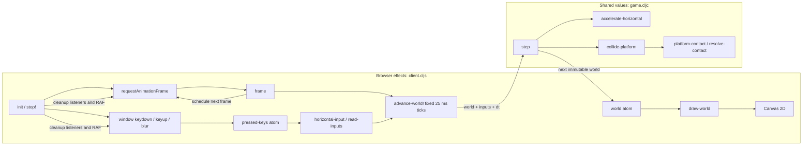

# Architecture

The current build is a local browser game. `game.cljc` owns deterministic world transitions; `client.cljs` owns input events, elapsed browser time, mutable storage, and Canvas drawing. There is no server or network boundary in this checkpoint.

See [Simulation](simulation.md) for current rules and [Simulation verification](simulation-verification.md) for local checks.

## Ownership

| Concern | Owner | Current entry points |
| --- | --- | --- |
| Scene and physics values | Shared simulation | `initial-world`, `step`, `accelerate-horizontal`, `collide-platform` |
| Key lifetime and direction | Browser client | `handle-key-down!`, `handle-key-up!`, `handle-blur!`, `horizontal-input`, `read-inputs` |
| Fixed simulation cadence | Browser client | `frame`, `advance-world!`, `tick-ms`, `max-frame-ms` |
| Current displayed world | Browser client | `world` atom |
| Canvas effects | Browser client | `draw-background`, `draw-platform`, `draw-player`, `draw-world` |
| Startup and cleanup | Browser client | `init`, `stop!` |

`frame` caps one measured frame interval at 100 ms, combines it with the fractional remainder from the prior frame, and advances as many complete 25 ms ticks as fit. Each tick reads current inputs and calls `game/step` with `0.025` seconds. Rendering occurs once after those simulation updates; it does not advance physics.

`game.cljc` is portable Clojure/ClojureScript code. Its `sqrt` function uses a reader conditional to select the JVM or JavaScript math implementation. All other browser effects stay in `client.cljs`. The simulation returns values; the client stores them with `swap!` and draws from the stored value.

`init` first calls `stop!`, then registers the keyboard and blur listeners, draws the current world, and starts animation frames. `stop!` removes those listeners, clears held keys, cancels a scheduled frame, and clears its frame ID. This makes the lifecycle's effects explicit and repeatable.
