# Architecture

`game.cljc` owns world data, support queries, movement, contact, and jump eligibility. `client.cljs` owns browser events, fixed-step scheduling, mutable references, and Canvas drawing.

```mermaid
flowchart LR
    subgraph Browser[Browser effects: client.cljs]
        Events[window keydown / keyup / blur]
        Keys[pressed-keys atom: A D W S]
        Pending[pending-jump / pending-drop atoms]
        Clear[handle-blur!: clear keys and both requests]
        Read[read-inputs]
        Consume[consume-inputs!: read, then clear both requests]
        RAF[requestAnimationFrame]
        Frame[frame: cap elapsed, carry remainder]
        Advance[advance-world!: complete 25 ms ticks]
        World[world atom]
        Draw[draw-world]
        Canvas[Canvas 2D]
        Lifecycle[init / stop!]
    end

    subgraph Shared[Shared values: game.cljc]
        Step[step]
        Jump[drop request or apply-jump]
        Eligibility[support / spawn lock / air allowance / drop ID]
        Motion[accelerate-horizontal / gravity]
        Collision[collide-platforms]
        Landing[supported top: unlock / restore allowance]
    end

    Events --> Keys
    Events -->|fresh non-repeat W or S| Pending
    Events -->|blur| Clear
    Lifecycle -->|stop calls| Clear
    Clear --> Keys
    Clear --> Pending
    Keys --> Read
    Pending --> Read --> Consume
    RAF --> Frame -->|elapsed + carried remainder| Advance
    Advance --> Consume
    Consume -->|inputs| Advance
    Advance -->|world + inputs + dt| Step
    Step --> Jump --> Eligibility --> Motion --> Collision
    Collision -->|supported top contact| Landing --> World
    Collision -->|other result| World
    World --> Draw --> Canvas
    Advance -->|fractional remainder| Frame
    Frame -->|schedule next frame| RAF
    Lifecycle --> Events
    Lifecycle -->|clear pending action; cancel frame| RAF
```

## Ownership and data flow

| Concern | Owner | Current functions or values |
| --- | --- | --- |
| World, support, jump eligibility, physics | Shared simulation | `initial-world`, `earliest-contact`, `semisolid-contact`, `grounded?`, `supporting-platform`, `apply-jump`, `step`, `collide-platforms` |
| Held directions and one-shot W/S requests | Browser client | `pressed-keys`, `pending-jump`, `pending-drop`, `handle-key-down!`, `handle-key-up!`, `handle-blur!` |
| Input snapshot and action lifetime | Browser client | `horizontal-input`, `read-inputs`, `consume-inputs!` |
| Frame clock and fixed ticks | Browser client | `frame`, `advance-world!`, `tick-ms`, `max-frame-ms` |
| Storage and presentation | Browser client | `world`, `draw-world`, Canvas drawing functions |
| Startup and cleanup | Browser client | `init`, `stop!` |

`frame` caps one measured interval at 100 ms and passes that elapsed time plus the prior fractional remainder to `advance-world!`. The latter processes every complete 25 ms tick and returns the new fractional remainder for `frame` to carry into the next animation frame. Each tick calls `consume-inputs!`, which snapshots `read-inputs` and then clears `pending-jump` and `pending-drop`; held A/D state remains. Quick W/S taps survive until a tick; only one tick receives each action.

`step` forces horizontal input to zero while spawn locked. It clears stale drop state, selects drop or `apply-jump` before gravity and movement, then resolves contact and clears finished drop state. Only a supported top contact unlocks spawn and restores the one air jump. Drawing happens after simulation and does not change world state.

`init` calls `stop!` before registering listeners and scheduling a frame. `stop!` removes listeners, clears held keys and pending W/S through `handle-blur!`, cancels the scheduled frame, and resets its ID. `game.cljc` uses a reader conditional for `sqrt`; browser APIs remain in `client.cljs`.

Platform geometry lives in the `:platforms` vector. `earliest-contact` selects
the earliest eligible surface, using stable platform IDs for equal times.
Solid entries use every face and rounded corner; semisolids filter this to
descending tops and upper endpoint arcs. The same remaining-time loop and
four-contact budget process both types.

The per-player `:drop-through-platform-id` belongs to immutable simulation
state. It changes surface eligibility for one platform only; neither the
platform vector nor the browser clock is modified to implement a drop.

The world stores identity-keyed records in `:players`. `make-player` constructs
fresh physics and input-eligibility values; `draw-world` reads every record.
At this stage `step` still accepts flat input and advances only `:player-1`;
the other three local fixtures are drawn but do not simulate yet.
