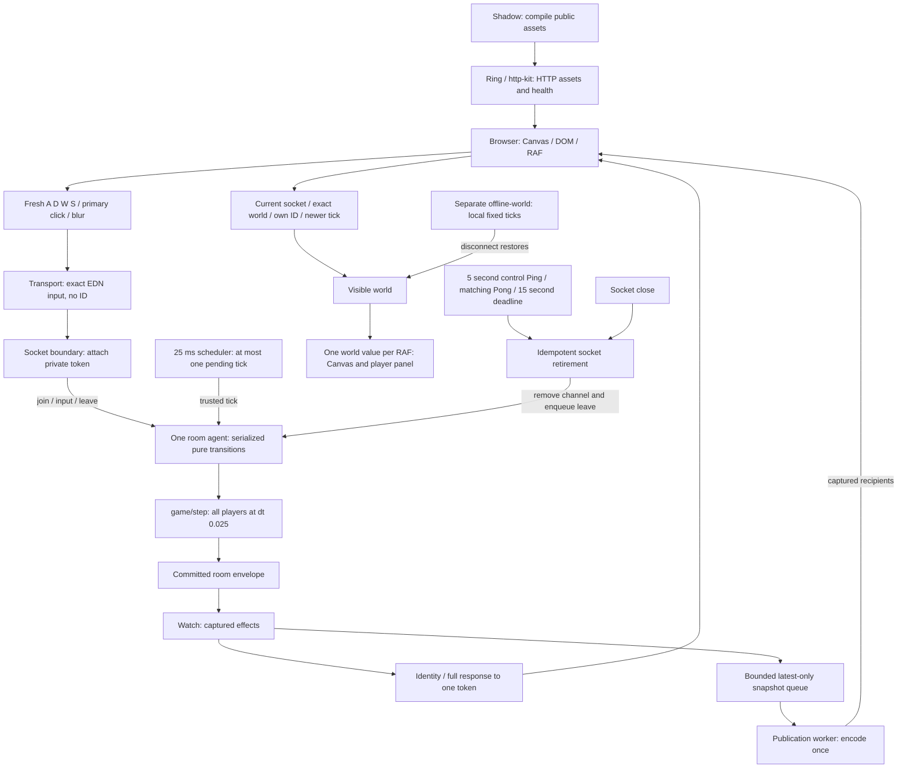

# Architecture

ClojureScript owns browser events and presentation. Clojure owns one
http-kit server, room agent, simulation scheduler, publication worker and
heartbeat scheduler. Shared `.cljc` functions operate on immutable values;
ClojureScript is the browser implementation of Clojure. See [Networking](networking.md)
for the wire contract and [Simulation](simulation.md) / [Combat](combat.md)
for physics and hit rules.

## Ownership and concurrency

Each accepted connection owns one private token and one public ID/color pair.
The agent owns all player records; players are immutable records rather than
separate agents. `send` serializes join/input/tick/leave transitions. The
scheduler submits tick actions through that same agent queue. Concurrent
callbacks cannot independently allocate capacity or mutate a body.

The agent stores `{:room ... :effects [...]}`. A watch observes the committed
envelope and delivers its captured effects. A snapshot contains both recipients
and world from that tick; publication never rereads the room to rebuild it.
A one-item queue replaces older pending snapshots outside the physics queue.
Tick overload drops pulses instead of accumulating catch-up. Input frames
still enqueue individual room actions; there is no input flood benchmark.

Only the server selects identity from a fresh connection token. Trusted tokens
are not EDN fields. Membership, inputs and bodies are inserted/removed in the
same transition. Monotonic IDs are independent of colors. Cookies and tabs do
not resume retired identities.

## Principal function contracts

| Function | Input → result | Effects / ownership |
| --- | --- | --- |
| `game/make-player` | body color, spawn X/Y → fresh player | Pure; starts locked with neutral motion/combat |
| `game/step` | world, input by existing player ID, dt → next world | Pure; moves all bodies, targets final positions, resolves hits once |
| `game/step-player` | player, platforms, intention, dt → next player | Pure; facing, cooldown, jump/drop, gravity, motion and swept contacts |
| `game/collide-platforms` | player, platforms, dt → resolved player | Pure; earliest surface/corner, remaining time and four-contact budget |
| `game/melee-target-ids` | players, attacker ID → target ID set | Pure; forward center-to-center half-disk of radius 60 |
| `game/apply-melee-hits` | players → resolved players | Pure; final percentage, summed impulse and sequence markers together |
| `protocol/read-client-message` | text/binary frame → input or error/reply | Safe EDN decoding; exact one-value contract, no evaluation |
| `protocol/merge-pending-input` | pending input, new input → merged input | Pure; latest direction, OR of one-shot actions |
| `protocol/snapshot-message?` | candidate → truthy/falsey | Pure; exact schemas, finite values and valid identities |
| `room/apply-room-message` | room, trusted message → room/effects envelope | Pure; join/input/tick/leave only; one 0.025-second step per tick |
| `room/make-room` | effect callback → room agent | Creates agent/watch; callback sees committed effects |
| `room/enqueue-room-message!` | agent, trusted message → agent | Enqueues serialized transition with `send` |
| `ticker/make-driver` | room agent → pulse/stop driver | At most one tick outstanding; scheduler owns 25 ms pulses |
| `publication/publish!` | worker handle, captured effect → nil | Replaces pending snapshot in bounded queue |
| `server/broadcast-world!` | channel registry, captured effect → nil | Encodes once and sends only captured recipients off room queue |
| `heartbeat/make-driver` | probe callback, optional monotonic clock → driver | Tracks matching challenges and deadline; separate from simulation time |
| `server/start!` / `stop!` | host/port/public-dir → handle; handle → nil | Owns and cleans HTTP, ticker, heartbeat, publication and queued leaves |
| `transport/start!` / `stop!` | page URL → fresh session; no arguments → closed | Derives endpoint, clears buffers and ignores old-socket callbacks |
| `transport/send-input!` | exact intention → no gameplay result | Sends immediately if admitted; otherwise coalesces for current session |
| `client/advance-world!` | elapsed milliseconds → fractional remainder | Disconnected: steps offline-world then copies to world; connected: discards time/actions |
| `client/frame` | canvas, previous time/remainder, RAF timestamp → next RAF | Reads visible world once for both renderers; does not predict network physics |
| `client/init` / `stop!` | no arguments | Owns listeners, RAF and transport; repeat startup leaves one loop |

## One complete simulation tick

1. Step each existing player once, using its owned intention or neutral input.
   Initial lock ignores voluntary movement/actions until supported landing.
2. Update facing/cooldown, choose semisolid drop before jump, apply acceleration,
   friction and gravity, then sweep surfaces and corners. Supported top contact
   unlocks spawn and restores one air jump. Drop ignores only its stored platform.
3. Freeze all resulting players for every newly accepted melee sequence.
   A miss consumes its sequence and cooldown too.
4. Group hits per target, add 10 percentage points per hit, calculate impulses at
   the final percentage, then store total/received velocities and resolved markers
   together. The added velocity moves the target on the next tick.
5. Commit world, increment room tick and consume one-shot input while retaining
   direction. Capture the snapshot for current members and publish after commit.

## Browser mode boundary

An OPEN socket with accepted admission suspends local physics, including while
waiting for its first snapshot. Snapshots must be strictly newer and include
the assigned ID. Both Canvas and panel read the same captured world per frame.
There is no interpolation or prediction.

Disconnected play advances a separate offline fixture world with capped 100 ms
frame intervals and complete 25 ms ticks. On mode transitions, pending local
actions and elapsed remainder are discarded. Disconnect restores that offline
copy, never a network world. Full/expired sessions preserve their Spanish
terminal notice; starting again is explicit.

Close/timeout retires delivery ownership once before submitting leave. Shutdown
stops owned schedulers/worker, closes HTTP channels and waits for room cleanup.
It does not stop unrelated processes. Real JVM socket tests and Node doubles
cover different boundaries; [Multiplayer verification](multiplayer-verification.md)
contains the native-browser and remote-device checklist.
