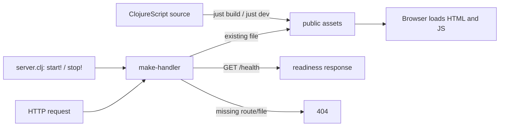
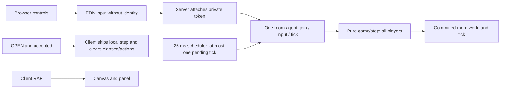
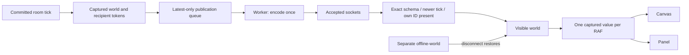

# Architecture

`game.cljc` owns world data, support queries, movement, contact, and jump eligibility. `client.cljs` owns browser events, fixed-step scheduling, mutable references, and Canvas drawing.

```mermaid
flowchart LR
    subgraph Browser[Browser effects: client.cljs]
        Keys[keydown / keyup: A D W S]
        Pointer[canvas primary pointerdown]
        Held[pressed-keys atom]
        Pending[pending jump / drop / attack atoms]
        Consume[consume-inputs!: keep direction, clear actions]
        RAF[RAF: cap 100 ms and carry remainder]
        Advance[advance-world!: complete 25 ms ticks]
        World[world atom]
        Snapshot[one world value per frame]
        Canvas[draw-world: Canvas 2D]
        Panel[render-players!: identity / swatch / percentage]
        Cleanup[blur / stop / init: clear input and old listeners]
    end
    subgraph Shared[Pure shared values: game.cljc]
        Step[step: existing player IDs]
        Player[step-player: facing / cooldown / jump or drop]
        Motion[voluntary and received X / gravity]
        Contact[collide-platforms: project both velocities]
        Final[all players after movement and contacts]
        Targets[new accepted sequences: query final snapshot]
        Hits[apply-melee-hits: pending sequences only]
        Effects[final percentage / summed impulse / resolved markers]
    end
    Keys --> Held
    Keys --> Pending
    Pointer --> Pending
    Held --> Consume
    Pending --> Consume
    RAF --> Advance
    Advance --> Consume
    Consume -->|input under player-1| Step
    Step --> Player --> Motion --> Contact --> Final
    Final --> Targets --> Hits --> Effects --> World
    World --> Snapshot
    Snapshot --> Canvas
    Snapshot --> Panel
    Advance -->|fractional remainder| RAF
    Cleanup --> Held
    Cleanup --> Pending
    Cleanup --> Pointer
    Cleanup --> RAF
```

## Ownership and data flow

| Concern | Owner | Current functions or values |
| --- | --- | --- |
| World, support, jump eligibility, physics | Shared simulation | `initial-world`, `earliest-contact`, `semisolid-contact`, `grounded?`, `supporting-platform`, `apply-jump`, `step-player`, `step`, `collide-platforms` |
| Held directions and one-shot actions | Browser client | `pressed-keys`, `pending-jump`, `pending-drop`, `pending-attack`, key/pointer handlers, `handle-blur!` |
| Cooldown, target selection and hit effects | Shared simulation | `step-melee`, `melee-target-ids`, `apply-melee-hits`, `melee-knockback-impulse` |
| Input snapshot and action lifetime | Browser client | `horizontal-input`, `read-inputs`, `consume-inputs!` |
| Frame clock and fixed ticks | Browser client | `frame`, `advance-world!`, `tick-ms`, `max-frame-ms` |
| Storage and presentation | Browser client | `world`, `draw-world`, `render-players!`, Canvas/DOM functions |
| Startup and cleanup | Browser client | `init`, `stop!` |

`frame` caps one measured interval at 100 ms and passes that elapsed time plus the prior fractional remainder to `advance-world!`. The latter processes every complete 25 ms tick and returns the new fractional remainder for `frame` to carry into the next animation frame. Each tick calls `consume-inputs!`, which snapshots `read-inputs` and then clears `pending-jump`, `pending-drop`, and `pending-attack`; held A/D state remains. Quick W/S taps and primary clicks survive until a tick; only one tick receives each action.

`step-player` forces horizontal input to zero while spawn locked. Accepted nonzero intention updates `:facing` before acceleration; neutral input preserves it. It clears stale drop state, selects drop or `apply-jump` before gravity and movement, then resolves contact and clears finished drop state. Only a supported top contact unlocks spawn and restores the one air jump. Drawing happens after simulation and does not change world state.

`init` calls `stop!` before registering listeners and scheduling a frame. `stop!` removes window listeners and the pointer listener from its stored `input-canvas`, clears held keys and all pending actions through `handle-blur!`, cancels the scheduled frame, and resets its ID. `game.cljc` uses a reader conditional for `sqrt`; browser APIs remain in `client.cljs`.

Platform geometry lives in the `:platforms` vector. `earliest-contact` selects
the earliest eligible surface, using stable platform IDs for equal times.
Solid entries use every face and rounded corner; semisolids filter this to
descending tops and upper endpoint arcs. The same remaining-time loop and
four-contact budget process both types.

The per-player `:drop-through-platform-id` belongs to immutable simulation
state. It changes surface eligibility for one platform only; neither the
platform vector nor the browser clock is modified to implement a drop.

The world stores identity-keyed records in `:players`. `make-player` constructs
fresh physics and input-eligibility values; `draw-world` reads every record.
`advance-world!` routes each consumed input to `local-player-id` (`:player-1`).
`step` reduces over the existing `:players` map, calling `step-player` once per
record with shared platform data and dt. Other IDs receive neutral input.
Unknown input IDs cannot add a player. Each movement result depends only on
that player, its input, and the shared platforms; combat then reads the common
final player map.

Facing belongs to each shared player record, not to keyboard state or velocity.
The browser only reads it to place the neutral white dot. Losing focus clears
input without changing the remembered side; contact resolution changes physics
without choosing a new side.

## Complete local tick

1. Route the consumed browser input under local `:player-1`. All other existing
   records receive neutral input. These are disconnected fixtures, not server
   sessions, and no automatic opponent supplies input.
2. For each player, clear stale drop state, accept facing/cooldown/strike while
   respecting the initial lock, choose drop before jump, update voluntary and
   received movement, and sweep contacts. Every record advances exactly once.
3. Freeze that resulting player map as the shared targeting snapshot. Only a
   newly accepted sequence searches its 60 px forward half-disk.
4. Group pending hits per target. Add all percentage first, calculate every
   contribution at that final percentage, and add the summed impulse to total
   and retained motion. Commit resolved markers for hits and misses together.
5. Return a new world. The browser stores it and gives the same frame value to
   Canvas and the panel. New impulses move on the next tick, not this one.

The simulation has no browser reads, clocks, atoms, or I/O. The room owner
calls the same `step` API with connection-owned inputs without changing
these local mechanics. See [Local combat](combat.md) for the field contracts.

## HTTP boundary

The Clojure HTTP process owns file delivery and readiness; Shadow owns compilation.
The browser owns fallback simulation; the admitted connection uses the room clock. `server/start!` returns its own
http-kit handle, and `stop!` settles that handle without touching other services.

## Room clock ownership

A tick calls `game/step` once, consumes pending actions, and retains horizontal
input. Server stop drains owned scheduler work. Snapshots connect the committed world to client drawing through a bounded
publication worker.

## Shared rendering boundary

`advance-world!` steps `offline-world` only when disconnected, then copies it to
`world`. While connected it drops elapsed time and actions. Transport's watch
replaces `world` with accepted snapshots without touching `offline-world`.
